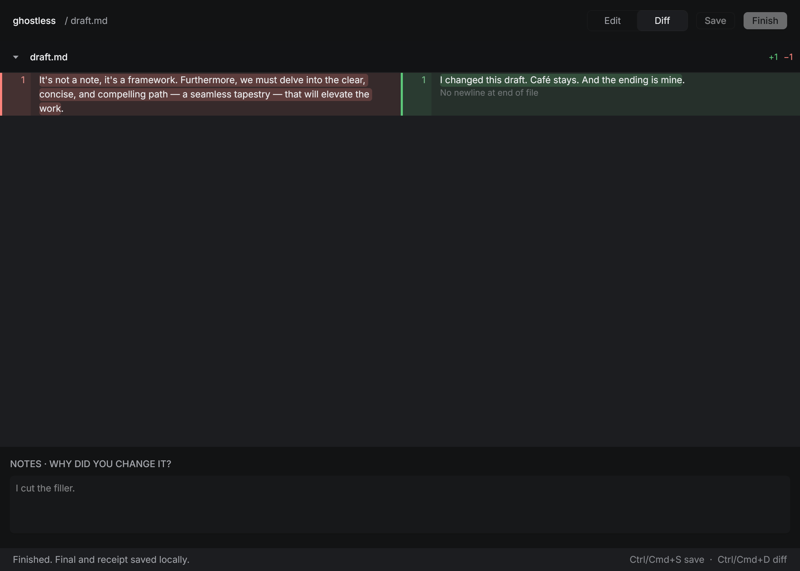

# Local desktop editor

The editor in `editor/` is a native [Rune](https://github.com/anomalyco/rune) app. `editor/Cargo.toml` pins Rune to commit `fa07f485dd52d8f66db317460566ef4dc4784821`. The UI has a read-only original, an editable working copy, notes, and a split word-level diff. It uses the same session files and Finish command as the CLI (see [SCHEMA.md](../SCHEMA.md#edit-sessions)).



Requirements for building from source: Rust 1.99+, Node 18+, Python 3.11+, and the native graphics libraries Rune requires for the host OS. A writer using a packaged editor should not need Rust. The editor calls the installed `ghostless` CLI; set `GHOSTLESS_CLI` to its executable path if it is not on `PATH`. From a checkout it uses `bin/ghostless` automatically.

```bash
cargo run --manifest-path editor/Cargo.toml -- --project /path/to/voice --draft /path/to/draft.md
```

This starts a new session (`ghostless start` under the hood). To resume a saved one:

```bash
ghostless sessions --project /path/to/voice
cargo run --manifest-path editor/Cargo.toml -- --project /path/to/voice --session <id>
```

Edits and notes save after an 800 ms pause. Ctrl/Cmd+S saves immediately; Ctrl/Cmd+D switches between Edit and Diff. Finish writes an immutable final and receipt and adds the pair to gold once. The editor then becomes read-only. The original draft (`before.md`) is never overwritten. If the app closes before Finish, reopen the session by ID and continue from `after.md`.

All text stays on the local filesystem. The editor invokes only the local CLI, with release checks disabled. Its session metadata uses UTF-8 and relative filenames, so copying a project between macOS, Windows, and Linux preserves the session. The exact file format is in [SCHEMA.md](../SCHEMA.md).

The separate distribution work in [issue #13](https://github.com/hirefrank/ghostless/issues/13) still needs signed or otherwise straightforward desktop installers and a clean-machine test of the combined CLI and editor. Native editor CI artifacts and editing tests are part of [issue #9](https://github.com/hirefrank/ghostless/issues/9).
