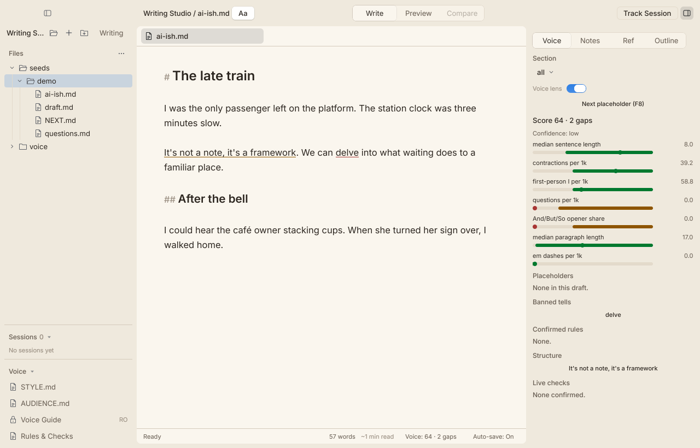

# Local desktop editor

This editor is not part of the npm package. `npm i -g ghostless` installs the CLI and the skills, not `editor/`. Every command below runs from a Git checkout, not from the installed package.

Prerequisites:

- A checkout of this repository (`git clone https://github.com/hirefrank/ghostless`)
- Rust 1.99+
- Node 18+ and Python 3.11+, because the editor calls the `ghostless` CLI
- The native graphics libraries Rune requires for the host OS
- A voice project with a non-empty draft. `ghostless init` creates a project. `ghostless start` rejects an empty file with `Draft is empty`, and the editor exits before it opens a window

```bash
git clone https://github.com/hirefrank/ghostless ~/Projects/ghostless
ghostless init /path/to/voice
ghostless build --project /path/to/voice
```

The editor in `editor/` is a native [Rune](https://github.com/anomalyco/rune) app. `editor/Cargo.toml` pins Rune to commit `fa07f485dd52d8f66db317460566ef4dc4784821`. The UI has a read-only original, an editable working copy, notes, and a split word-level diff. It uses the same session files and Finish command as the CLI (see [SCHEMA.md](../SCHEMA.md#edit-sessions)).



A writer using a packaged editor should not need Rust. That packaged build is not shipped: the [Rune editor workflow](../.github/workflows/editor.yml) uploads a per-OS binary on every push, and those binaries are not release assets. The editor calls the installed `ghostless` CLI; set `GHOSTLESS_CLI` to its executable path if it is not on `PATH`. From a checkout it uses `bin/ghostless` automatically.

## Start from a draft

```bash
cargo run --release --manifest-path editor/Cargo.toml -- --project /path/to/voice --draft /path/to/draft.md
```

Build once with `cargo build --release --manifest-path editor/Cargo.toml` and run `editor/target/release/ghostless-editor` directly if you would rather not go through `cargo run`. From a checkout where that binary exists, `ghostless edit /path/to/draft.md` does the same start-and-open step. Pass exactly one of `--draft` or `--session`.

`--project` is optional. The editor uses the same resolution as the CLI: `--project`, then `GHOSTLESS_PROJECT`, then a voice project in the current directory, then `defaultProject` from `ghostless use`. A missing project or draft path names that path. When the directory is not a voice project yet, the message points at `ghostless init`.

This starts a new session (`ghostless start` under the hood).

## Resume a saved session

```bash
ghostless sessions --project /path/to/voice
cargo run --release --manifest-path editor/Cargo.toml -- --project /path/to/voice --session <id>
```

Edits and notes save after an 800 ms pause. Ctrl/Cmd+S saves immediately; Ctrl/Cmd+D switches between Edit and Diff. Finish writes an immutable final and receipt and adds the pair to gold once. The editor then becomes read-only. The original draft (`before.md`) is never overwritten. If the app closes before Finish, reopen the session by ID and continue from `after.md`.

All text stays on the local filesystem. The editor invokes only the local CLI, with release checks disabled. Its session metadata uses UTF-8 and relative filenames, so copying a project between macOS, Windows, and Linux preserves the session. The exact file format is in [SCHEMA.md](../SCHEMA.md).

The separate distribution work still needs signed or otherwise straightforward desktop installers and a clean-machine test of the combined CLI and editor. Nothing open tracks that installer work: [issue #13](https://github.com/hirefrank/ghostless/issues/13) closed with the cross-platform CLI, and [issue #9](https://github.com/hirefrank/ghostless/issues/9) closed with the editor itself.
